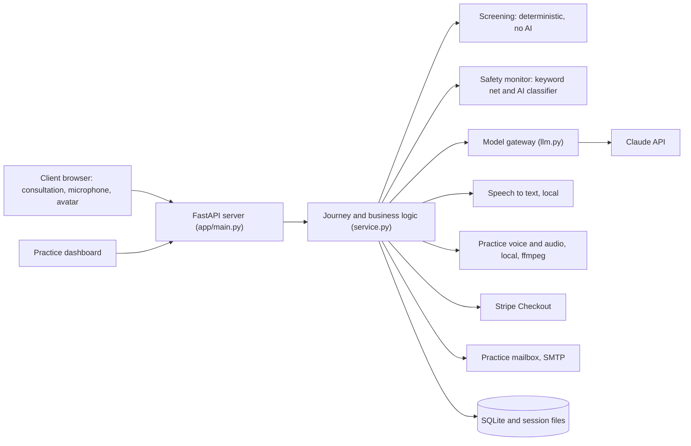
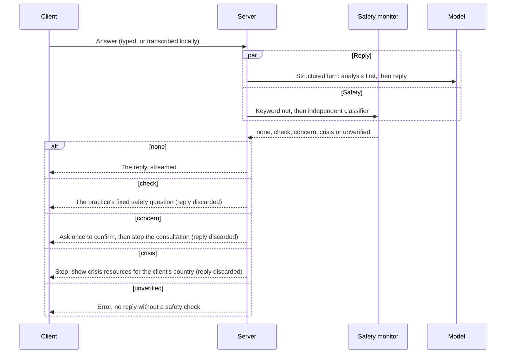
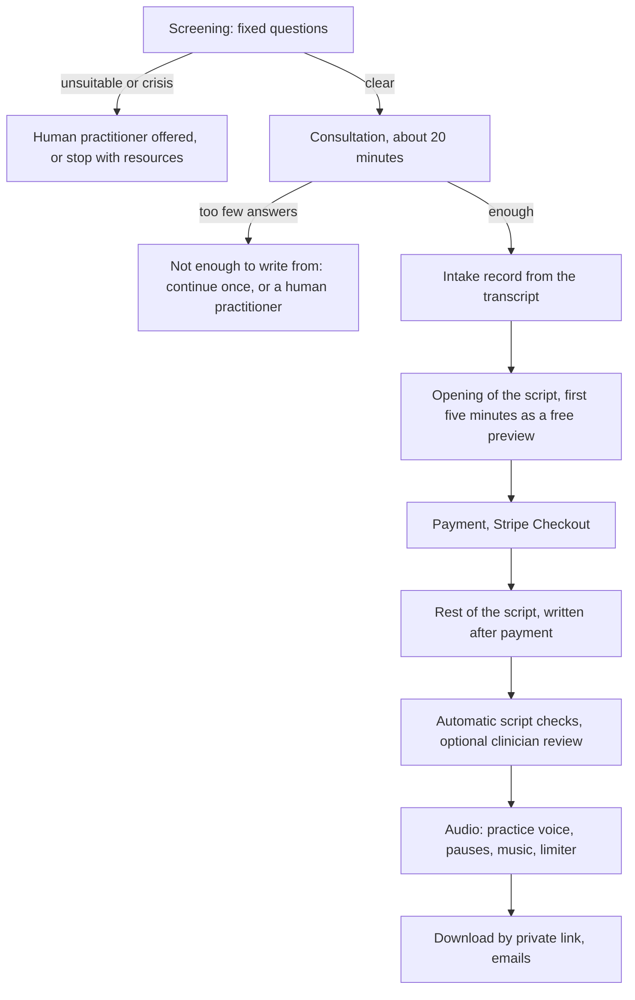

# Architecture

## Components

One FastAPI server holds the whole journey. The browser client and the clinician dashboard are static pages served by the same server. State lives in SQLite and in session files on disk.

`app/llm.py` is the only module that talks to the Claude API, so limits, logging and fakes in tests all live in one place. A second engine, which runs the same prompts through the Claude Code command line, exists for local testing on the owner's own machine and is never used for real clients.

## One consultation turn

The reply is generated at the same time as the safety check, and it is discarded unless the safety result is clear. The client does not wait for the check, and nothing unchecked can reach them.

Every decision is stored as a risk event with its evidence, rationale, keyword hits and source, so the practice can audit what happened.

## The journey

Time rules protect both the client and the cost. The client's clock starts with their first answer, a minute of silence brings a gentle fixed check-in, two minutes pause the consultation, and paused time never counts. The server closes abandoned consultations itself.

## Script writing and checks

The script is written in two steps so that nothing is spent on the whole session before payment: first the opening, from which the preview is made, then the rest as a continuation. Before delivery, automatic checks confirm that the sections are present and in order, that the required safety lines are there, that the emergence ends with the client alert (except for sleep sessions), that the length is within limits, and that clinician notes and delivery notes are never spoken. A truncated script is flagged.

## Knowledge and learning

- **Retrieval.** Curated notes are indexed by section and searched with BM25 (stemmed keyword search). Exclusion is structural and fails closed: a note file is only retrievable if every catalogue row that mentions it is tagged as core craft, and sections marked as excluded, flagged or cautionary are dropped before indexing.
- **Books.** A PDF is read, checked by the model for suitability, turned into technique notes in the model's own words, and used only after the practice approves the notes.
- **Learning loop.** Clinician reviews and client feedback are distilled into proposed lessons, and a lesson only affects future scripts after a clinician approves it.

## Voice and audio

- **Listening.** The browser records an answer and sends the audio. The server turns it into words with faster-whisper. If that is unavailable, the browser's own speech recognition takes over, and if neither exists the client is told to type.
- **Speaking.** The practice voice is a real, consenting speaker's recording, spoken by a local text-to-speech model. The consultation keeps its natural pace. In the session only the pace is slowed (pitch unchanged), each piece rises and settles softly, and the silences are lengthened or shortened so the session lasts 60 to 85 minutes. The voice itself is never altered.
- **Files.** Each session lives in its own folder (speech, the pieces and their lengths, the job settings, the preview and the finished MP3). Interrupted work carries on from the last finished piece, and audio is deleted after a set number of days.

## Configuration

Behaviour is set by environment variables, with the defaults in `.env.example`: the engine, the models (a cheaper one for books), the effort for each kind of call, the consultation length and turn limits, the languages offered, the payment provider (a clearly marked test checkout or Stripe), whether clinician review is required, and the audio retention period.

## What I would improve next

- Add browser-level tests (for example with Playwright) for the client, which currently has none.
- Measure the risk classifier on a labelled set of safe and unsafe messages in all four languages.
- Move from keyword retrieval to a hybrid of keywords and embeddings, and compare the two on real script-writing queries.
